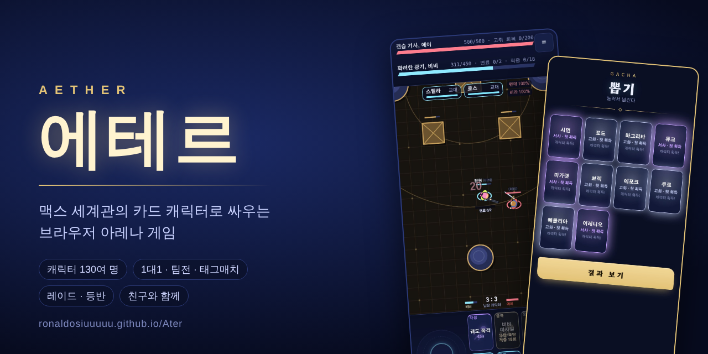
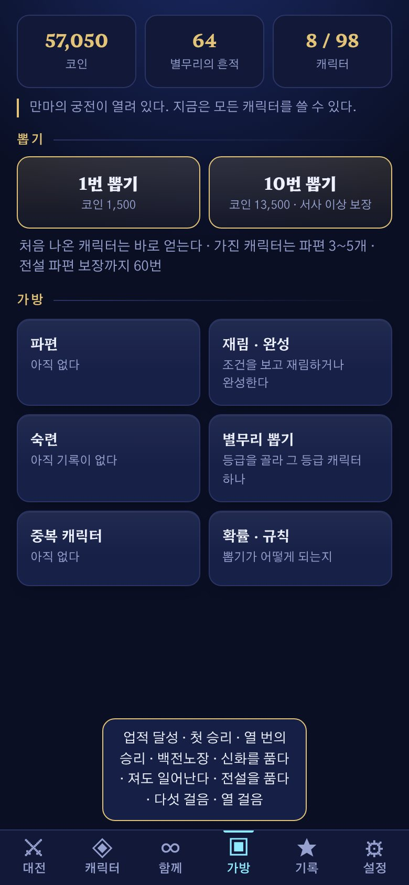
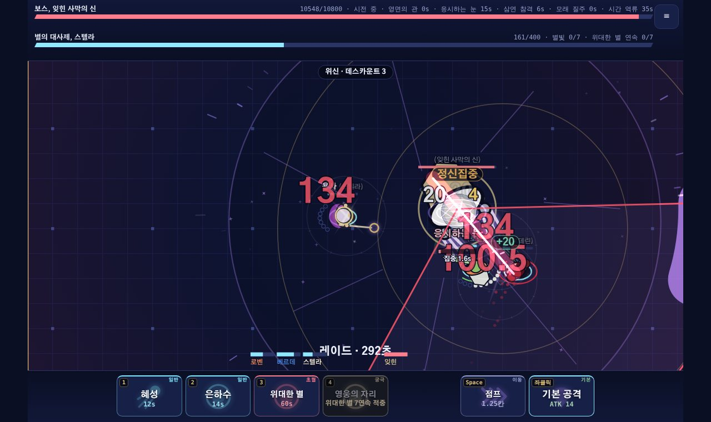

# 에테르 · AETHER

**오래도록 꿈꿔온 여정의 시작.**
맥스 세계관의 캐릭터를 이용해 전투하는 브라우저 아레나 게임입니다.

### [▶ 지금 하기](https://ronaldosiuuuuu.github.io/Ater/)

설치 없이 휴대폰 · PC 브라우저에서 바로 가능합니다. 홈 화면에 추가하면 앱처럼 쓸 수 있습니다.

    

---

## 화면

| 시작 화면 | 대전 화면 | 3대3 태그매치 | 가방 |
|:---:|:---:|:---:|:---:|
|  |  |  |  |

## 무엇을 하는 게임인가

- **카드 그대로의 캐릭터 133명**: 고화 26 · 서사 35 · 전설 29 · 히든 5 · 신화 3명과 재림 카드 35장. 스킬 수치는 카드 원문을 따른다.
- **여러 방식**
  - 1대1 단판 · 5판 3선승, 2 · 3 · 5대 팀 섬멸전 · 킬 선취, 점령전, 대돌격(마왕 하나 대 용사 넷)
  - 3대3 태그매치: 셋을 골라 한 명씩 나서고 교대하며 싸운다.
  - 레이드: 보스 31종, 난이도 5단계(소란 · 집결 · 결속 · 군주 · 위신), 편이 함께 쓰는 데스카운트
  - 등반(층 오르기 · 권능 · 장비), 이야기(정사 장면), 오늘의 도전, 연습
- **모으고 키우기**: 코인 뽑기(처음 나온 캐릭터는 바로 얻고, 이미 가진 캐릭터는 파편), 별무리 뽑기, 재림 · 완성, 숙련, 계정 레벨, 임무, 업적
- **친구와 함께**: 방 코드나 초대 링크로 모인다. 대전 · 팀전 · 태그매치 · 레이드 · 등반을 같이 하고, 준비 표시 · 채팅도 있다. 서버 없이 기기끼리 바로 잇는다(P2P).

## 조작

| | 휴대폰 | PC |
|---|---|---|
| 움직이기 | 화면 왼쪽 아래를 누르고 민다 | W · A · S · D |
| 기본 공격 | 「기본 공격」 단추(누르고 있으면 계속) | 왼쪽 클릭 또는 J |
| 스킬 | 스킬 단추 · 누른 채 밀면 방향 지정 | 1 · 2 · 3 · 4 (5~8), 마우스로 조준 |
| 점프 · 웅크리기 | 「점프」 · 「웅크리기」 단추 | Space · Shift |
| 멈춤 · 스킬 원문 | 오른쪽 위 ≡ | Esc |
| 태그 교대 | 위쪽 교대 단추 | Q · E |
| 채팅 | 💬 · 아래 채팅 줄 | T |

처음이라면 게임 안의 **첫 판 안내**(1분)가 하나씩 알려 준다. 설정에서 왼손 배치 · 조작 단추 크기 · 그림 품질을 바꿀 수 있다.

## 친구와 함께 하는 법

1. 한 사람이 **함께** 탭 → **방 만들기**를 누르고, 코드나 **초대 링크**를 보낸다.
2. 나머지는 링크를 열고 **들어가기**를 누르거나, 함께 탭에서 코드를 적고 들어온다.
3. 각자 캐릭터를 고르고 **준비하기**를 누른다. 방장이 방식을 정하고 **싸우기**를 누른다.

같은 방에 있었던 사람은 함께 탭 **최근 함께한 사람**에 남는다. **친구로**를 눌러 두면 다음부터는 방을 만든 뒤 친구 옆 **초대**로 바로 부른다(친구가 게임을 켜 두고 있을 때).

모두 같은 판(버전)이어야 들어갈 수 있다. 판이 다르다고 나오면 새로고침한다.

## 만든 방식

- 빌드 없는 순수 JavaScript + Canvas 2D. `index.html`을 열면 바로 돌아간다.
- 오프라인에서도 되는 PWA(서비스 워커), 기기끼리 잇는 WebRTC(PeerJS). 직접 닿지 못하면 사이트에 마련된 중계 서버(TURN)를 저절로 거친다.
- 기록은 지금 그 기기의 브라우저에 저장된다.

변경 기록은 [CHANGELOG.md](CHANGELOG.md)에 있다. 버그나 제안은 [Issues](https://github.com/ronaldosiuuuuu/Ater/issues)에 남겨 주면 된다. 보안 문제는 공개 이슈 대신 [SECURITY.md](SECURITY.md)에 적힌 방법으로 알려 준다.

---

## 저작권

© 2026 ronaldosiuuuuu. All rights reserved.
게임과 캐릭터 · 카드 · 코드 · 그림의 저작권은 ronaldosiuuuuu에게 있다. 허락 없이 가져다 쓰거나 다시 배포할 수 없다.
