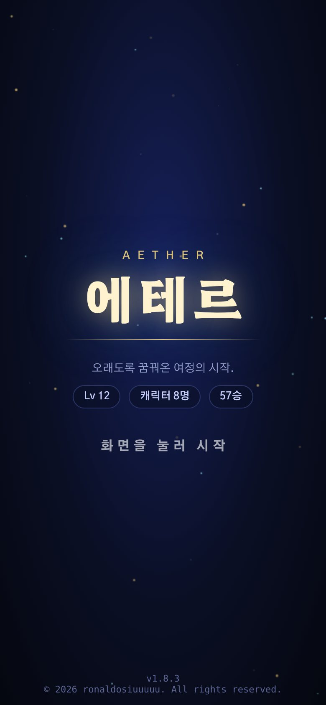
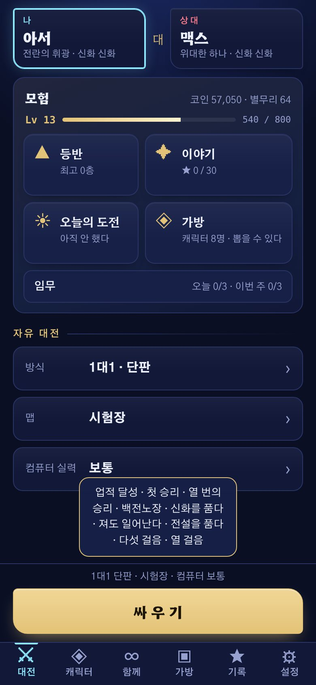
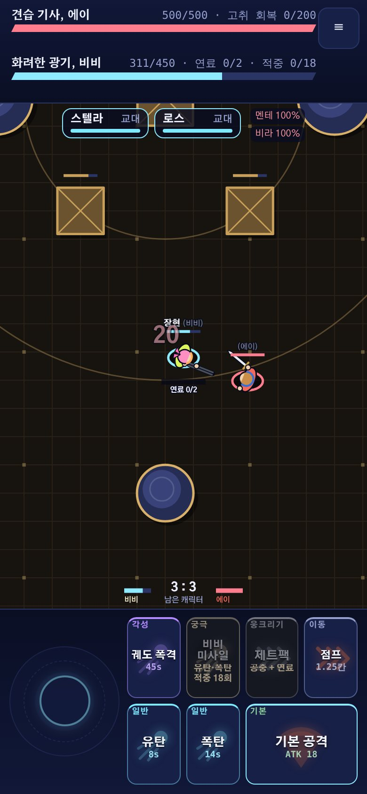
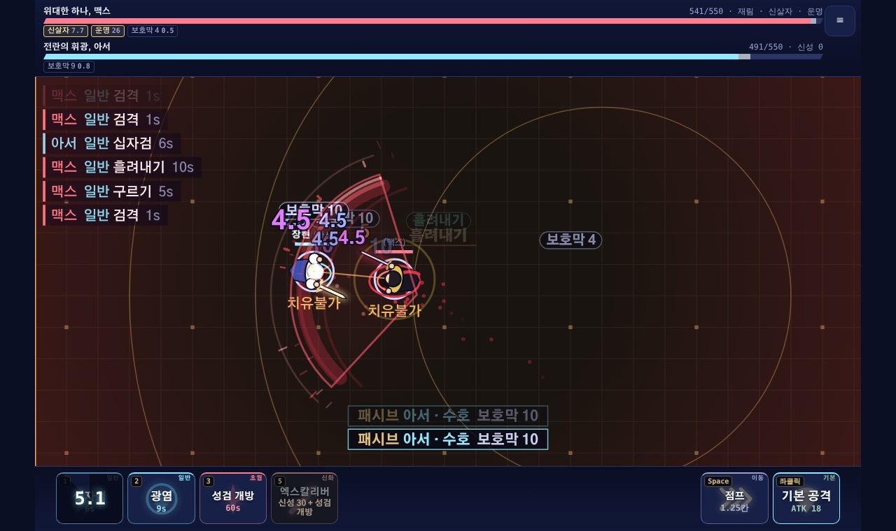

# 에테르 · AETHER

**오래도록 꿈꿔온 여정의 시작.**
맥스 세계관의 카드 캐릭터로 싸우는 브라우저 아레나 게임

### [▶ 지금 하기](https://ronaldosiuuuuu.github.io/Ater/)

설치 없이 휴대폰 · PC 브라우저에서 바로 된다. 홈 화면에 추가하면 앱처럼 쓸 수 있다(PWA).

   

---

## 화면

| 시작 화면 | 대전 화면 | 3대3 태그매치 | 가방 |
|:---:|:---:|:---:|:---:|
|  |  |  |  |

## 무엇을 하는 게임인가

- **카드 그대로의 캐릭터 133명**: 고화 26 · 서사 35 · 전설 29 · 히든 5 · 신화 3명과 재림 카드 35장. 스킬 수치는 카드 원문을 따른다.
- **여러 방식**
  - 1대1 단판 · 5판 3선승, 2 · 3 · 5대 팀 섬멸전 · 킬 선취, 점령전, 대돌격(마왕 하나 대 용사 넷)
  - 3대3 태그매치: 셋을 골라 한 명씩 나서고 교대하며 싸운다.
  - 레이드: 보스 31종, 난이도 5단계(소란 · 집결 · 결속 · 군주 · 위신), 편이 함께 쓰는 데스카운트
  - 등반(층 오르기 · 권능 · 장비), 이야기(정사 장면), 오늘의 도전, 연습
- **모으고 키우기**: 코인 뽑기(처음 나온 캐릭터는 바로 얻고, 이미 가진 캐릭터는 파편), 별무리 뽑기, 재림 · 완성, 숙련, 계정 레벨, 임무, 업적
- **친구와 함께**: 방 코드나 초대 링크로 모인다. 대전 · 팀전 · 태그매치 · 레이드 · 등반을 같이 하고, 준비 표시 · 채팅도 있다. 서버 없이 기기끼리 바로 잇는다(P2P).

## 조작

| | 휴대폰 | PC |
|---|---|---|
| 움직이기 | 화면 왼쪽 아래를 누르고 민다 | W · A · S · D |
| 기본 공격 | 「기본 공격」 단추(누르고 있으면 계속) | 왼쪽 클릭 또는 J |
| 스킬 | 스킬 단추 · 누른 채 밀면 방향 지정 | 1 · 2 · 3 · 4 (5~8), 마우스로 조준 |
| 점프 · 웅크리기 | 「점프」 · 「웅크리기」 단추 | Space · Shift |
| 멈춤 · 스킬 원문 | 오른쪽 위 ≡ | Esc |
| 태그 교대 | 위쪽 교대 단추 | Q · E |
| 채팅 | 💬 · 아래 채팅 줄 | T |

처음이라면 게임 안의 **첫 판 안내**(1분)가 하나씩 알려 준다. 설정에서 왼손 배치 · 조작 단추 크기 · 그림 품질을 바꿀 수 있다.

## 친구와 함께 하는 법

1. 한 사람이 **함께** 탭 → **방 만들기**를 누르고, 코드나 **초대 링크**를 보낸다.
2. 나머지는 링크를 열거나 함께 탭에서 코드를 적고 들어온다.
3. 각자 캐릭터를 고르고 **준비하기**를 누른다. 방장이 방식을 정하고 **싸우기**를 누른다.

모두 같은 판(버전)이어야 들어갈 수 있다. 판이 다르다고 나오면 새로고침한다.

## 만든 방식

- 빌드 없는 순수 JavaScript + Canvas 2D. `index.html`을 열면 바로 돌아간다.
- 오프라인에서도 되는 PWA(서비스 워커), 기기끼리 잇는 WebRTC(PeerJS) + 중계 서버(TURN)
- 기록은 지금 그 기기의 브라우저에 저장된다.

변경 기록은 [CHANGELOG.md](CHANGELOG.md)와 [릴리스](https://github.com/ronaldosiuuuuu/Ater/releases)에 있다. 버그나 제안은 [Issues](https://github.com/ronaldosiuuuuu/Ater/issues)에 남겨 주면 된다.

---

<b>개발자용: 파일 구성</b>

| 파일 | 내용 |
|---|---|
| index.html | 화면·메뉴·엔진(이동, 피해, 상태, 그리기, 소리, 입력) |
| chars.js | 고화 26명 + 마나난·시먼·네르티나·밀리오 |
| seosa1~3.js | 서사 29명 (seosa3 끝에 겉모습·진행·상태 표) |
| jeon1~3.js | 전설 24명 (jeon3 끝에 겉모습·진행·상태 표) |
| rebirth.js | 재림 32명 |
| sinhwa.js | 신화 3명 + 재림 3명(아르트랑 맥스 · 여명의 훼광 아서 · 궁창의 혼재 아에르) |
| extra.js | 뒤에 더한 12명: 듀크 · 울펜하임 · 테오르 · 알비온 · 키비 · 비비 · 스타트 + 히든 아몬 · 알론소 · 라사 · 천갈 · 나가토 (겉모습·상태·운용법 포함) |
| team.js | 다인전에서 아군에게 주는 효과 |
| look.js · fxs.js | 겉모습(몸·무기) · 스킬 연출과 소리 |
| brain.js · brain2.js · brain3.js | 컴퓨터 운용법 |
| cardtext*.js | 카드 원문(스킬 보기 화면용). cardtext6.js가 extra.js의 12명 |
| maps.js | 맵 자료(크기·색·기둥·발판) |
| feel.js | 타격감·스킬 윤곽선·속성 타격음·궁극기 경고(훅으로 붙인 덧붙임 파일) |
| bench.js | 컴퓨터끼리 대전표(승률 재기) |
| raid.js | 레이드의 보스 몬스터 셋(마석 골렘 · 초 거대 마석 골렘 · 여덟 머리의 뱀)과 전리품 |
| lore.js | 세계관 글(노션 정리본에서 뽑음) |
| forge.js · guide.js | 카드로 캐릭터 만들기 · 길잡이 |
| `build.js` | 조합 캐릭터 만들기(스킬 네 칸 + 권능 3 + 특전 2 + 장비 3). 권능 `POWERS`(카드 권능은 손으로, 시험장 권능은 `[이름, 단계, 수치 묶음]` 한 줄), 장비 `GEAR`(무기 · 방어구 · 장신구, 공설~신화), 수치 묶음의 낱말은 `MODTXT` |
| `kits.js` | 무기·권능 스킬 묶음의 틀(`defKit`). 키트의 스킬은 조합 캐릭터의 '가져오기'에 나오고, 같은 이름의 장비·권능을 달면 빈 단추(x1~x4)에 붙으며 패시브가 함께 온다 |
| `wkits1.js` `wkits2.js` | 카드 무기의 스킬(2024~2025 · 2026). 수치는 카드 그대로, 정한 것은 각 키트의 `note` |
| `pkits.js` | 카드의 활성 권능(神聖 - 힘 · 영웅 · 정복, 천변만화의 별 등) |
| `foes.js` | 시험장에서 만든 적 25종(`MOBS`)과 보스 10종(`BOSSES`). 한 줄씩 적는 자료 꼴. 등반 보스 순서는 `TBOSS` |
| `game.js` | 모험: 등반(보상 · 갈림길 · 상인 · 보스), 이야기(`STORY`), 오늘의 도전, 등급 해금(`NEEDS`), 기록 · 업적(`ACH`), 승리 평가. 이 기기에만 남는다(`aetherProfile`, `aetherTower`) |
| net.js · peerjs.min.js | 친구와 함께(P2P 방). PeerJS 1.5.4(MIT)를 그대로 넣었다 |

화면: 휴대폰 가로·세로, PC 모두 된다. 판을 시작할 때 화면이 넓으면 경기장이 눕고(38×26, 내가 왼쪽), 길면 선다(26×38, 내가 아래). 설정에서 방향을 자동·가로 고정·세로 고정으로 고른다.

## 휴대폰에 앱으로 깔기 (PWA)

https 주소로 올린 뒤 휴대폰 크롬(또는 삼성 인터넷)으로 열면 고르는 화면 아래에 '홈 화면에 앱으로 깔기' 단추가 뜬다(안 뜨면 브라우저 메뉴의 '홈 화면에 추가' / '앱 설치'). 깔고 나면 주소창 없이 전체 화면으로 뜨고, 인터넷이 없어도 돈다.

- `manifest.json` 앱 이름·아이콘·전체 화면 선언, `sw.js` 오프라인 저장, `icons/` 아이콘.
- 인터넷이 될 때는 늘 새 파일을 받아 쓰므로, 올려 둔 파일을 고치면 앱을 다시 열 때 바로 반영된다.
- 파일을 새로 더하면 `sw.js`의 `FILES`에 이름을 적고 `V`의 숫자를 올린다.
- 파일을 그냥 열거나(file://) http로 열면 앱으로 깔 수 없다. 게임은 그대로 돈다.

## 화면 짜임 (앱 기준)

- 고르는 화면은 네 쪽이다: 대전(방식·맵·실력) · 캐릭터(찾기·최근·등급·직업·무작위) · 함께(방) · 설정. 세로는 아래 탭, 가로는 왼쪽 탭, PC는 위 탭. 나·상대 칸과 싸우기 단추는 늘 보인다.
- 뒤로 가기(안드로이드)는 열린 것부터 닫고, 싸우는 중에는 멈춘다. 싸우는 동안에는 화면이 꺼지지 않는다(되는 기기에서).
- 설정에서 조작 단추 크기(작게~아주 크게)와 왼손 배치를 바꾼다. 알림은 아래에 잠깐 뜨는 쪽지(`toast()`)로 나온다.

## 친구와 함께 (P2P 방)

고르는 화면의 '친구와 함께'에서 한 사람이 방을 만들고, 나머지는 방 코드 네 글자로 들어온다. 모두 같은 주소(https로 올린 곳)를 열어야 한다.

- 싸움은 방장 기기에서 돌아간다. 들어온 사람은 조작을 보내고, 방장이 1초에 15번 보내는 화면 상태를 받아 그린다. 그래서 들어온 쪽은 조작이 조금 늦게 먹는다.
- 방장이 방식(1대1 · 3대3 · 5대5 · 점령전 · 대돌격) · 맵 · 컴퓨터 실력을 정하고 '싸우기'를 누르면 모두 시작한다. 사람이 모자란 자리는 컴퓨터가 채운다. 최대 10명.
- 연결은 PeerJS의 공개 중계 서버로 서로를 찾은 뒤 기기끼리 바로 주고받는다(WebRTC). 통신사·공유기에 따라 연결이 안 될 수 있다.
- 주소 뒤에 `?bc`를 붙여 열면 같은 브라우저의 탭끼리 붙는다(인터넷 없이 시험할 때).

## 늘리는 법

- **맵 더하기**: `maps.js`의 `MAPS`에 한 덩이를 적는다. 좌표는 세로 경기장 기준으로 한 번만 적으면 가로 화면에서는 엔진이 눕힌다. 고르는 화면 단추와 미리보기는 저절로 생긴다.
- **놓을 수 있는 것**: 기둥 `pillar` · 상자 `crate`(부서짐) · 발판 `pad` · 문 `gate` · 폭풍 `storm`. 점령 지점 `cap`은 점령전에서 엔진이 가운데에 놓는다.
- **맵에 놓는 것 더하기**: `index.html`의 `FEAT`(종류: `draw`, 필요하면 `step`)와 `PADS`(발판: 이름·색·`speed` 또는 `every`+`tick`)에 한 줄.
- **설정 더하기**: `SETTINGS`에 한 줄. 단추 줄과 저장이 저절로 붙고, 값은 `OPT.이름`으로 읽는다.
- **덧붙임 파일**: 엔진을 고치지 않고 `on('hit',fn)`처럼 훅을 건다. 훅은 `begin` `end` `hit` `kill` `cast` `step` `draw:world` `draw:screen`. `feel.js`가 본보기이고, 새 파일은 `index.html` 맨 아래에 `<script>` 한 줄로 더한다.
- **캐릭터 더하기**: 예전과 같다. `CH`에 캐릭터, `CARDTEXT`에 원문, `LOOK`에 겉모습, `BRAIN`에 운용법.

서버 기준값(설정에서 바꿈): 달리기 5.6칸/초 · 기본 공격 0.5초마다 · 손이 닿는 거리 3칸(부채꼴 좌우 37.5도) · 근접·범위 스킬 기본 넉백 0.5칸(카드에 밀치기가 적힌 스킬은 적힌 대로, 투사체는 없음).

규칙: 수치는 카드 원문 그대로. 카드에 없어 정한 것은 각 캐릭터의 `note`에 적는다.

## 올리기 · 앱으로 깔기 · 여러 기기

`배포.md`에 차례대로 적었다. 파일을 고쳐 다시 올릴 때는 `sw.js`의 `V`와 `net.js`의 `APPV`를 함께 올린다(열려 있는 앱이 알아서 새 판으로 바뀌고, 판이 다른 기기끼리는 방에 들어갈 때 알려 준다).

## 버전

`x.y.z` — 맨 앞은 대규모 패치, 가운데는 어느 정도 규모가 있는 패치, 맨 뒤는 마이너 패치(밸런스 조정 · 버그 수정). 내보낼 때 `game.js`의 `VER`과 `PATCH`(패치 내역, 들어올 때 뜨는 창), `sw.js`의 `V`, `net.js`의 `APPV`(서로 같은 판인지 확인하는 숫자)를 함께 올린다.

## 저작권

© 2026 ronaldosiuuuuu. All rights reserved.
맥스 세계관과 캐릭터 · 카드의 저작권은 ronaldosiuuuuu에게 있다. 코드와 그림을 허락 없이 가져다 쓰거나 다시 배포할 수 없다.
